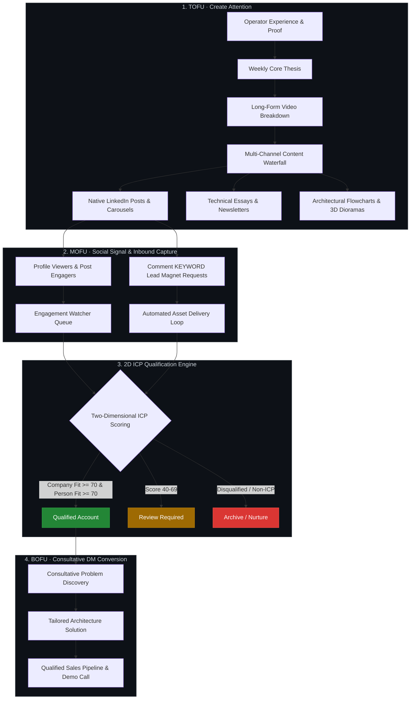
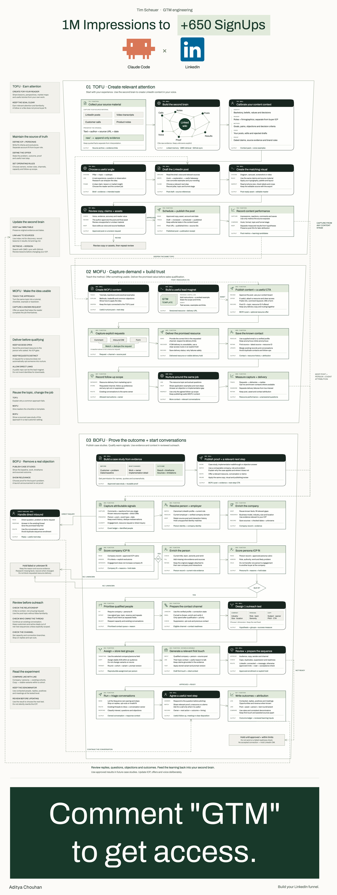

# LinkedIn Funnel

[](LICENSE)
[](https://www.python.org/)
[](skills/README.md)
[](AGENTS.md)
[](https://github.com/Aditya-chouhan/linkedin-funnel/actions)

**The full-funnel LinkedIn growth and B2B pipeline engineering system.**

Turn deep technical expertise into high-converting content, qualify inbound engagement with calibrated ICP rubrics, and drive qualified sales pipeline through consultative DM conversion.

Created by **[Aditya Chouhan](https://github.com/Aditya-chouhan)**.

---

## The Full-Funnel Architecture

Traditional LinkedIn growth creates empty impressions. This system treats your LinkedIn presence as an engineered B2B pipeline:



---

## What Is Included

| Component | What it gives you | Reference |
|---|---|---|
| **50 Agent Skills** | Modular, drop-in instructions for research, copywriting, 3D dioramas, video editing, qualification, and outreach. | [Browse all 50 skills](skills/README.md) |
| **The Content Waterfall** | Turn 1 core technical thesis a week into 10+ high-leverage assets across LinkedIn, X, and newsletters. | [Waterfall guide](guides/content-waterfall.md) |
| **Personal-Brand Second Brain** | Store your positioning, audience insights, proven receipts, tone, and visual brand rules in Git. | [Context architecture](context/README.md) |
| **2D ICP Qualification Engine** | Score prospect company and persona fit separately using strict rubrics and JSON schemas. | [Qualification guide](guides/qualification.md) |
| **Deterministic CLI Suite** | Python CLI tools to score leads (`qualify.py`), generate weekly plans, and validate schemas. | [`scripts/`](scripts/) |
| **Consultative DM Framework** | Non-salesy conversation scripts to deliver assets, identify bottlenecks, and book calls. | [DM conversion](guides/dm-conversion.md) |
| **Visual Architecture System** | Editable Excalidraw maps, 3D Three.js dioramas, and system animations. | [`assets/`](assets/) |
| **Full Automated Test Suite** | 100% test coverage for skill frontmatters, JSON schemas, asset hashes, and scoring logic. | [`tests/`](tests/) |

---

## The Visual Maps

### 1. The Content Waterfall System
[](guides/content-waterfall.md)
*Transform 1 idea per week into a long video, technical newsletter, system map, carousels, and tactical posts.*
- [High-Resolution Still](assets/content-waterfall@2x.png)
- [Editable Excalidraw Source](assets/content-waterfall.excalidraw)
- [Full Waterfall Guide](guides/content-waterfall.md)

### 2. The Comprehensive Funnel Map
[](guides/sources.md)
*The complete blueprint from top-of-funnel reach to bottom-of-funnel pipeline conversion.*
- [Animated Workflow Walkthrough](assets/linkedin-funnel.gif)
- [Editable Excalidraw Blueprint](assets/linkedin-funnel.excalidraw)

---

## The 50 Agent Skills Library

All skills live in the **[`skills/`](skills/)** directory and are automatically discovered by **OpenAI Codex**, **Claude Code**, and **Google Antigravity** via `.agents/skills` and `.claude/skills`.

### 1. Context & Second Brain (4 Skills)
- [`capture-context`](skills/capture-context/SKILL.md) — Extract structured author context from interview notes, calls, and transcripts.
- [`voice-calibration`](skills/voice-calibration/SKILL.md) — Calibrate your writing voice from past samples without generic AI phrasing.
- [`setup-workspace`](skills/setup-workspace/SKILL.md) — Initialize brand preferences, local configurations, and Notion databases.
- [`qmd`](skills/qmd/SKILL.md) — Search and retrieve context with repo-scoped search.

### 2. Content Strategy & Copywriting (10 Skills)
- [`content-strategy`](skills/content-strategy/SKILL.md) — Define pillars, sub-arguments, and funnel jobs from audience and offer.
- [`linkedin-copywriter`](skills/linkedin-copywriter/SKILL.md) — Draft high-impact LinkedIn posts grounded in verified proof.
- [`linkedin-hook-writer`](skills/linkedin-hook-writer/SKILL.md) — Craft mobile-optimized opening hooks with strict character limits.
- [`lead-magnet-creator`](skills/lead-magnet-creator/SKILL.md) — Build actionable lead magnets with worked examples and clear payoffs.
- [`long-form`](skills/long-form/SKILL.md) — Write structured, argument-driven technical essays.
- [`newsletter-writer`](skills/newsletter-writer/SKILL.md) — Author high-signal email newsletters around one central thesis.
- [`repurpose-content`](skills/repurpose-content/SKILL.md) — Deconstruct long-form recordings into multi-format assets.
- [`researcher`](skills/researcher/SKILL.md) — Conduct primary source-backed B2B industry research.
- [`week-posts`](skills/week-posts/SKILL.md) — Plan and draft an entire week of cohesive content.
- [`x-copywriter`](skills/x-copywriter/SKILL.md) — Produce punchy, evidence-based X posts and threads.

### 3. Visuals & System Architecture (5 Skills)
- [`flowchart`](skills/flowchart/SKILL.md) — Create clean, editable architectural maps and funnels in Excalidraw.
- [`diorama-3d`](skills/diorama-3d/SKILL.md) — Build 3D Three.js dioramas representing systems as interactive places.
- [`graphics-designer`](skills/graphics-designer/SKILL.md) — Design clean editorial carousels and banners adhering to brand tokens.
- [`brand-system`](skills/brand-system/SKILL.md) — Establish visual design tokens, typography, and color palettes.
- [`brand-review`](skills/brand-review/SKILL.md) — Review visual layouts for clarity, contrast, and hierarchy.

### 4. Video & Media Engineering (7 Skills)
- [`youtube-script`](skills/youtube-script/SKILL.md) — Script engaging long-form technical breakdowns with strong demo beats.
- [`youtube-thumbnail`](skills/youtube-thumbnail/SKILL.md) — Design legible, high-CTR YouTube thumbnails matching video promises.
- [`youtube-description`](skills/youtube-description/SKILL.md) — Generate SEO chapters, timestamps, and resource links.
- [`youtube-publisher`](skills/youtube-publisher/SKILL.md) — Manage metadata and uploads for YouTube videos.
- [`launch-video`](skills/launch-video/SKILL.md) — Build narrative product launch videos from beat scripts.
- [`video-use`](skills/video-use/SKILL.md) — Edit videos via source-preserving transcripts and timelines.
- [`video-editor`](skills/video-editor/SKILL.md) — Produce publish-ready talking head edits with captions and -14 LUFS audio.

### 5. Content Waterfall Orchestration (12 Skills)
- [`content-waterfall`](skills/content-waterfall/SKILL.md) — Master orchestrator: turn 1 idea into a weekly multi-platform engine.
- [`youtube-video-research`](skills/youtube-video-research/SKILL.md) — Validate niche demand and cross-niche packaging before recording.
- [`youtube-title-outlier-packaging`](skills/youtube-title-outlier-packaging/SKILL.md) — Benchmark proven packaging structures for A/B titles.
- [`youtube-thumbnail-outlier-research`](skills/youtube-thumbnail-outlier-research/SKILL.md) — Research visual thumbnail outliers in your niche.
- [`x-article-writer`](skills/x-article-writer/SKILL.md) — Write deep-dive native technical articles for X.
- [`linkedin-article-adapter`](skills/linkedin-article-adapter/SKILL.md) — Port long-form articles into native LinkedIn formats.
- [`x-planner`](skills/x-planner/SKILL.md) — Plan and sequence X content slates across 3 strategic lanes.
- [`talking-head-video-cut`](skills/talking-head-video-cut/SKILL.md) — Precision cut pauses and false starts from raw footage.
- [`longform-edit`](skills/longform-edit/SKILL.md) — Combine animated intros with polished screen walkthroughs.
- [`lead-magnet-delivery`](skills/lead-magnet-delivery/SKILL.md) — Automated comment-to-DM delivery loops.
- [`linkedin-unibox-reply`](skills/linkedin-unibox-reply/SKILL.md) — Draft high-converting consultative DM replies.
- [`x-research`](skills/x-research/SKILL.md) — Extract viral niche topics and discussions from X.

### 6. Social Listening & Smart Engagement (2 Skills)
- [`linkedin-engage`](skills/linkedin-engage/SKILL.md) — Queue insightful comments on watchlist creator posts with real receipts.
- [`x-engage`](skills/x-engage/SKILL.md) — High-signal replies on targeted industry threads.

### 7. Advanced Motion & Shorts (6 Skills)
- [`manim-video`](skills/manim-video/SKILL.md) — Create mathematical and algorithmic animations in Manim.
- [`shorts-cut`](skills/shorts-cut/SKILL.md) — Cut vertical video takes with exact word boundary preservation.
- [`shorts-motion`](skills/shorts-motion/SKILL.md) — Add cue-aligned motion graphics to short-form clips.
- [`shorts-audio`](skills/shorts-audio/SKILL.md) — Professional noise suppression and audio leveling.
- [`shorts-edit`](skills/shorts-edit/SKILL.md) — Assemble complete short-form videos with captions and graphics.
- [`shorts-qa`](skills/shorts-qa/SKILL.md) — Verify frame pacing, caption alignment, and audio levels.

### 8. Pipeline & Workflow Orchestration (4 Skills)
- [`oxygen-linkedin-marketing`](skills/oxygen-linkedin-marketing/SKILL.md) — Manage warm-signal motions, posts, and tables.
- [`oxygen-quickstart`](skills/oxygen-quickstart/SKILL.md) — Configure profile watching and engagement tracking.
- [`oxygen-sequencer`](skills/oxygen-sequencer/SKILL.md) — Bounded, non-spammy outreach sequences.
- [`oxygen-unibox`](skills/oxygen-unibox/SKILL.md) — Centralized message inbox triage and account routing.

---

## Quickstart

### Step 1: Clone and Open in Your Agent

```bash
git clone https://github.com/Aditya-chouhan/linkedin-funnel.git
cd linkedin-funnel
```

Open the folder in your preferred AI environment:
- **OpenAI Codex**: Automatically reads `AGENTS.md` and discovers `.agents/skills`.
- **Claude Code**: Automatically reads `CLAUDE.md` and discovers `.claude/skills`.
- **Google Antigravity**: Discovers all skills from `skills/` and instructions in `AGENTS.md`.

### Step 2: Seed Your Context

Prompt your agent to capture your positioning and tone:

```text
Read AGENTS.md and README.md. Help me populate my personal-brand context.
Use setup-workspace, capture-context and voice-calibration to ingest my
audience, offer, and writing samples. Ask me for the few missing details that
matter, keep unknown claims empty, and draft my first useful LinkedIn
post in chat using linkedin-copywriter.
```

### Step 3: Run the Content Waterfall

Kick off your weekly content sprint:

```text
Read guides/content-waterfall.md. Run the content-waterfall skill for this week.
My thesis: "How We Scaled B2B Pipeline Using Agentic Workflows".
Generate the weekly schedule, draft the flagship newsletter, and map out the
supporting LinkedIn posts and architecture flowchart.
```

---

## Deterministic CLI Tools & Python Package

The project is packaged as a standard Python module and CLI (`linkedin-funnel`). You can install it locally in editable mode:

```bash
pip install -e .
```

### 1. ICP Qualification CLI
Evaluate prospective leads deterministically against `templates/icp-rubric.md` and validate with `templates/qualification-output.schema.json`:

```bash
linkedin-funnel qualify examples/qualification-decisions.json
# or via standalone script:
python3 scripts/qualify.py examples/qualification-decisions.json
```

Output:
```json
{
  "company_score": 90.0,
  "persona_score": 90.0,
  "company_disqualified": false,
  "persona_disqualified": false,
  "fit_status": "qualified",
  "company_reason": "Strong B2B ICP match with ideal headcount and industry alignment.",
  "persona_reason": "High-leverage economic buyer or direct functional decision-maker.",
  "missing": [],
  "evidence_used": [
    "Business model: b2b saas",
    "Target headcount tier: 45 employees",
    "Target vertical: enterprise software",
    "Executive leadership with primary revenue and GTM budget ownership"
  ]
}
```

### 2. Content Waterfall Sprint Planner
Generate a complete 7-day multi-channel sprint schedule from a core topic:

```bash
linkedin-funnel waterfall "Full-Funnel Pipeline Architecture" --pillar "GTM Engineering"
# or via standalone script:
python3 scripts/content_waterfall_planner.py "Full-Funnel Pipeline Architecture" --pillar "GTM Engineering"
```

### 3. Template & Schema Verification
Ensure zero broken links, valid skill frontmatters, and exact asset hash matches:

```bash
linkedin-funnel verify
# or via standalone script:
python3 scripts/check-template.py
python3 context/scripts/wiki_lint.py
```

---

## Automated Test Suite

Run the full unit test suite:

```bash
python3 -m unittest discover tests -v
```

Verification covers:
- All 50 skills have valid YAML frontmatters matching `skills/catalog.json`.
- `.agents/skills` and `.claude/skills` symlinks resolve correctly.
- All JSON files match Draft-07 schemas.
- Deterministic qualification engine scores properly across edge cases.
- All asset SHA-256 hashes match `assets/manifest.json`.
- Unified CLI subcommands execute with zero exit codes.

---

## Repository Structure

```text
linkedin-funnel/
├── .agents/skills/            # Discovery symlink for OpenAI Codex & Antigravity
├── .claude/skills/            # Discovery symlink for Anthropic Claude Code
├── .github/workflows/ci.yml   # GitHub Actions automated test & verification pipeline
├── assets/                    # System maps, animations, and editable Excalidraw files
├── company/                   # ICP and buyer persona templates
├── context/                   # Personal-brand second brain (identity, voice, audience)
├── examples/                  # Synthetic calibration data & test cases
├── guides/                    # In-depth architectural guides (waterfall, DM, qualification)
├── linkedin_funnel/           # Python package (CLI, qualification, waterfall, validator)
├── scripts/                   # Deterministic Python CLI tools & verification scripts
├── skills/                    # 50 modular, agent-ready skills with full SKILL.md specs
├── templates/                 # ICP rubrics, qualification prompts, and JSON schemas
├── tests/                     # Comprehensive test suite (skills, schemas, scoring, CLI)
├── AGENTS.md                  # Multi-agent operating protocol
├── CLAUDE.md                  # Claude Code operating protocol
├── CONTRIBUTING.md            # Contribution guidelines & testing standards
├── LICENSE                    # MIT License (Aditya Chouhan)
├── pyproject.toml             # Python package configuration
└── README.md                  # Primary documentation and system blueprint
```

---

## License & Credits

Created by **[Aditya Chouhan](https://github.com/Aditya-chouhan)**.

Licensed under the **[MIT License](LICENSE)**. You are free to fork, adapt, commercialize, and build upon this system.
